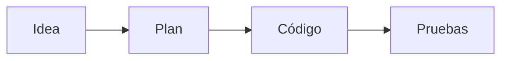

# Tinta 1.3.0 — biblioteca de plantillas, diagramas y teclado personal

## Abrir la nueva versión

Cierra la versión anterior normalmente y abre `Tinta-1.3.0-Windows/Tinta-win32-x64/Tinta.exe`. Junto al nombre Tinta aparece **1.3**. Conserva la carpeta completa; si usas el ZIP, extráelo primero.

La app usa la misma colección en `%APPDATA%\Tinta`. Antes del primer guardado de una colección existente crea `notes.before-v1.3.0.json`, sin reemplazar snapshots anteriores. El esquema de datos sigue siendo 1. Las versiones 1.0, 1.1 y 1.2 conservan sus ejecutables y ZIP.

## Plantillas a la vista

La sección **Plantillas** ahora muestra las 17 plantillas incluidas y tus plantillas personales. Puedes buscar y filtrar por **Estudio, Desarrollo, Investigación, Planning, Organización y Mis plantillas**.

Las plantillas incluidas son de consulta: pulsa **Crear nota con esta plantilla** para obtener una copia editable. No se agregan como notas a la colección ni se duplican al actualizar. Tus plantillas personales siguen siendo editables. Al crear una plantilla personal desde una categoría, la app abre **Mis plantillas**.

Una nota vacía muestra **Elegir una plantilla**. También puedes usar **Ctrl+T**, o el atajo que configures. Se conserva el título personalizado y la identidad de esa nota; nunca se sustituye texto existente con el atajo.

Nuevas estructuras:

| Categoría | Plantillas |
| --- | --- |
| Investigación | Codebase exploration, Hang bug, Bug report, Dependency bug |
| Desarrollo | Performance improvement |
| Estudio | Reading summary, Concept deep dive |
| Planning | Feature planning, Refactoring plan |

Se mantienen sesión de estudio, Cornell, revisión de código limpio, patrones de diseño, despliegue, tareas, investigación de errores y decisiones de arquitectura. Cada estructura tiene preguntas concretas y campos entre corchetes para rellenar.

## Etiquetas y menú contextual

Pulsa **+ Etiqueta**, escribe y presiona **Enter**. Puedes seguir añadiendo etiquetas en el mismo campo. Las existentes aparecen como sugerencias; usa flechas y Enter o haz clic. Escape sale del campo. Las etiquetas repetidas con distinta capitalización no se añaden de nuevo.

Haz **clic derecho** sobre una nota para moverla de libreta, duplicarla, fijarla como favorita, copiar su enlace o ID, exportar HTML/PDF/Markdown o moverla a la papelera. En la papelera puedes restaurar o solicitar eliminación definitiva, que requiere confirmación. También se abre con **Shift+F10** cuando la tarjeta de la nota tiene el foco.

Los selectores y menús usan el tema activo. Se añadieron transiciones suaves y animación al cerrar los diálogos. Se respeta la preferencia de reducir movimiento de Windows.

## Bloques de código con contexto

Añade metadatos en la primera línea del bloque:

````markdown
```rust filename="src/main.rs" line=99 title="Punto de entrada"
fn main() {
    println!("Hola mundo");
}
```
````

`filename` muestra la ruta, `title` una descripción y `line` el número inicial. Usa comillas para valores con espacios. La ruta es una etiqueta descriptiva: no abre ni lee archivos de tu equipo. El resaltado del lenguaje se conserva.

## Mermaid

````markdown

````

Los diagramas se dibujan localmente, se adaptan a Oscuro, Claro y Gruvbox, y también se incluyen como gráficos en las exportaciones HTML/PDF. No necesitan un servicio externo. Si hay un error de sintaxis, se muestra un aviso y se conserva el texto para corregirlo.

Se usa Mermaid 12.2.0 en modo estricto. No se permiten scripts, enlaces ejecutables ni configuración incrustada mediante directivas/front matter. Hay límites de tamaño para evitar que un diagrama bloquee el editor. Los estilos del diagrama se controlan desde el tema de Tinta.

## Atajos editables

En **Preferencias → Personalizar atajos de teclado**, pulsa una combinación y luego las teclas que quieras usar. Se detectan colisiones con otras acciones y se reservan las combinaciones habituales de edición y Windows. Puedes restablecer los valores iniciales.

| Acción | Atajo inicial |
| --- | --- |
| Nueva nota | Ctrl+N |
| Buscar y abrir | Ctrl+K |
| Buscar en todas las notas | Ctrl+Shift+F |
| Cambiar vista | Ctrl+Shift+P |
| Modo enfoque | Ctrl+. |
| Preferencias | Ctrl+, |
| Guardar | Ctrl+S |
| Plantilla en nota vacía | Ctrl+T |
| Duplicar nota | Ctrl+D |
| Exportar vista previa | Ctrl+Shift+E |
| Mover a papelera | Ctrl+Shift+Backspace |

Los comandos internos de Vim y CodeMirror mantienen sus teclas. En Vim, Ctrl+N/P siguen reservados para el editor cuando este tiene el foco. En la lista de notas, Delete mueve la nota seleccionada a la papelera. Ctrl+P conserva su alias anterior de búsqueda mientras no se asigne a otra acción.

## Ollama configurado para este equipo

Se descargó y seleccionó **qwen2.5-coder:3b**, un modelo local de 3,1B parámetros en Q4_K_M, para la RTX 3060 Ti de 8 GB detectada. Es una elección orientada a sugerencias breves con margen de memoria para el escritorio. La integración conserva contexto limitado a 4.096 tokens, hasta 6.000 caracteres antes del cursor y 1.000 después. El modelo permanece cargado hasta cinco minutos de inactividad.

La predicción queda activada en la configuración de IA de este equipo. Puedes desactivarla o cambiar de modelo en Preferencias. **Tab** acepta la sugerencia y **Esc** la descarta; en Vim funciona en insertar. Las sugerencias son editables y no se guardan hasta aceptarlas.

Se probaron continuaciones de texto y código con datos ficticios. Tras cargar el modelo se observaron aproximadamente 0,1–0,5 segundos de generación en las últimas consultas directas; la primera carga puede tardar bastante más y el editor espera una pausa de escritura antes de solicitar una sugerencia. La prueba final dentro del ejecutable tardó unos siete segundos desde insertar el prefijo hasta aceptar y guardar, incluyendo la pausa de escritura y carga. Estos tiempos son observaciones, no una garantía. Se corrigieron espacios entre palabras y cercas de código redundantes que devolvía el modelo.

Tinta usa exclusivamente el servidor local `127.0.0.1:11434`, rechaza modelos identificados como remotos y no envía el resto de la colección. El archivo `ollama.json` está separado de notas y copias JSON. La descarga del modelo requiere internet; la generación local no. Hermes no es necesario para esta conexión y no se modificó su configuración.

## Exportación y versiones

Se mantiene **Opciones → Exportar vista previa** con HTML/PDF y tema independiente. Mermaid y los encabezados de código se conservan. PDF adapta el documento a A4; no es una captura de los paneles. Las referencias internas se conservan como texto y las imágenes web siguen necesitando conexión. Markdown y backups JSON permanecen disponibles.

Desarrollo en `feat/template-library-diagrams-shortcuts`, en un worktree separado. Solo después de las pruebas se fusiona a `main` y se etiqueta `v1.3.0`. `Tinta-1.3.0-repositorio.bundle` conserva el historial completo; el ZIP de código contiene el código etiquetado. No se publicó nada en un repositorio remoto.

Para desarrollar: `npm ci`, `npm run build`, `npm test`. Pruebas de interfaz: `npm run test:desktop`, `npm run test:desktop:v11`, `npm run test:desktop:v12`, `npm run test:desktop:v13`. La prueba opcional `node tests/ollama-real.cjs` requiere `TINTA_REAL_OLLAMA_MODEL` y siempre usa una colección ficticia aislada.

Referencias: [Qwen2.5-Coder en Ollama](https://ollama.com/library/qwen2.5-coder), [API local de generación](https://docs.ollama.com/api/generate), [Mermaid y nivel de seguridad](https://mermaid.js.org/config/usage).
